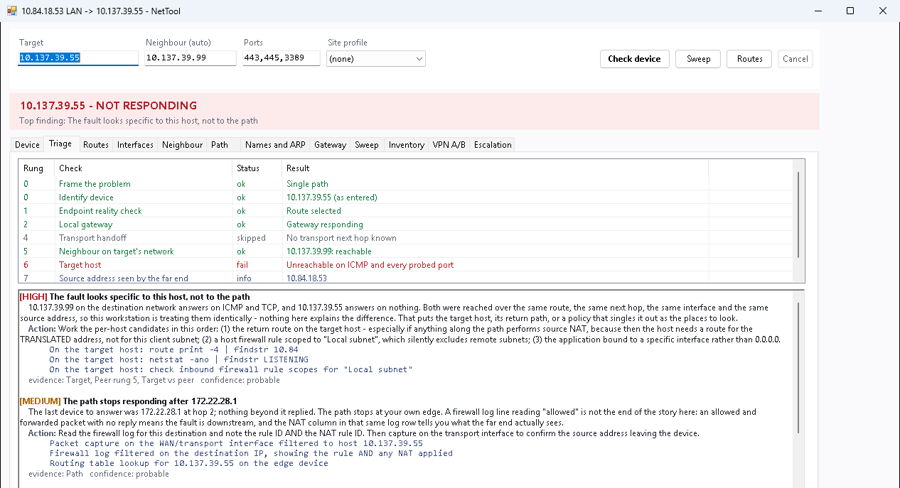

# NetTool

A WinForms tool for **Windows PowerShell 5.1** for the ticket that says "this PC can't reach that server". Point it at a device (a name off the ticket, an IP address or a MAC address) and it finds the device, works out which address it really has, and walks a triage ladder: the routing table, hosts file and ARP, the gateway, a working neighbour on the target's network, and the path. Then it **tells you what it thinks is wrong and why**, with the evidence attached so you can disagree with it.

From [ihavenoram.com](https://ihavenoram.com): field notes for ADHD techs running managed services.



## Download

Grab **`nettool.zip`** from **[Releases](../../releases/latest)**. It holds one folder, `nettool\`, with only what runs: the scripts and a `.cmd` launcher for each. Copy that folder to the PC or server (for example `C:\temp\nettool`); this README and the docs stay here on GitHub. The SHA-256 checksum is in the release notes and in the `.sha256` file beside the zip:

```powershell
Get-FileHash .\nettool.zip -Algorithm SHA256
```

## Run it

Double-click **`Launch-NetTool.cmd`** (it starts PowerShell with `-STA`, which WinForms needs). No admin rights are needed except for the Fix button.

Type a device into **Target** and press **Check device**. Leave **Neighbour (auto)** blank: the tool finds a host on the target's network to compare against when it needs one. Ranges and CIDRs go to **Sweep**.

**In ScreenConnect Backstage**, copy the whole `nettool` folder to the machine and run `Launch-NetTool.cmd` there. (If you'd rather carry a single script, `Build-NetToolSingleFile.ps1` in this repo builds one; it isn't in the download.) Copy it to the machine and run it with `powershell.exe -NoProfile -STA -ExecutionPolicy Bypass -File NetTool-Standalone.ps1`.

## What it's good at

- **Finding the device properly.** A name is asked of the hosts file, DNS, mDNS, LLMNR and NetBIOS separately, so a stale DNS record or a VPN overlay's hosts entry doesn't send you after the wrong address. A PC sitting on `169.254.x.x` with no DHCP lease is found and called out.
- **Separating "the path is broken" from "one host is broken".** It compares the target with a neighbour on the same network over the same route, next hop, interface and source address. If the neighbour answers and the target doesn't, the workstation is ruled out.
- **Route audits that tell active from leftover.** A persistent route Windows hasn't installed is reported as configuration residue, not as today's fault. Routes bound to a disconnected VPN adapter, a missing interface or a next hop that only resolves through another broken route are each named.
- **The window title shows the address this PC is sourcing traffic from**, and whether a VPN gives it a second way out. That changes silently when a VPN connects.
- **VPN A/B**: capture, connect or disconnect the VPN, capture again, and see what actually changed.
- **Escalation**: a paste-ready summary of what's proven working, what's ruled out, and the commands to run on the edge device.

## What it can't see

It can't observe source NAT done downstream, read the firewall log, or tell a closed port from a filtered one, and it says so instead of guessing. A conclusion that rests on an assumption, such as an assumed `/24`, is labelled as one. If a VPN is carrying the route to the target, every conclusion is marked provisional. The full list is in [docs/TECHNICAL.md](docs/TECHNICAL.md).

## Site profiles

Copy `profiles\_template.json` to `profiles\<site>.json` and fill in what you know: LAN subnets, the transport hand-off, known NAT, and a known-good neighbour for each important server. The profile is picked automatically whenever the PC has an address in one of its subnets, so someone who has never seen the site can run a proper triage. Your profiles describe your clients' networks; the included `.gitignore` keeps them out of git.

## Files

| File | Purpose |
|---|---|
| `Launch-NetTool.cmd` | Launcher (forces `-STA`) |
| `NetTool-Gui.ps1` | The GUI and background workers |
| `NetTool.Helpers.ps1` | All the diagnostic logic. Functions only, no side effects at load |
| `NetTool_HTML_Report.ps1` / `Launch-NetTool-Report.cmd` | Turn an exported JSON report into one HTML file |
| `Build-NetToolSingleFile.ps1` | Repo only, not in the download: builds a one-file copy if you'd rather carry a single script |
| `profiles\_template.json` | Documented blank site profile |
| `docs/TECHNICAL.md` | The full reference |

## Notes

- Windows PowerShell 5.1, no modules. Without internet access, MAC vendor names read `Unknown`.
- It's read-only except the **Fix** button, which needs elevation and confirms every action. The hosts file is backed up before an edit; route deletions aren't automatically reversible.
- Sweeps send real traffic and can trip IDS or EDR. Ranges over 1,024 addresses ask first.
- Saved state goes to `C:\ProgramData\NetToolkit` and to `inventory\` and `baselines\` beside the scripts. All of it describes real networks.

## About

Built with AI assistance (Claude) from a real inter-site case. It's provided as is, with no warranty. Check how your EDR and your customers' monitoring will react before sweeping or probing.

MIT licensed; see [LICENSE](LICENSE).
